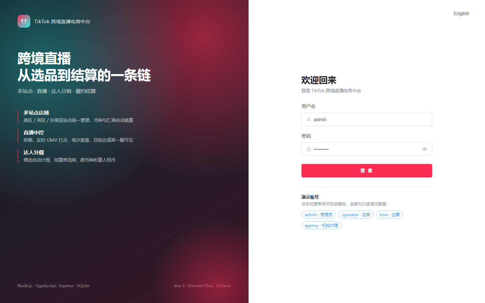
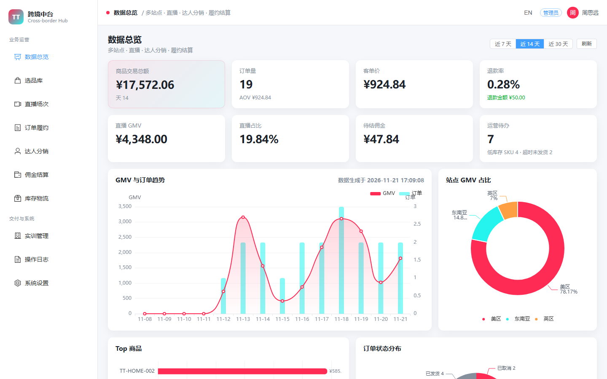
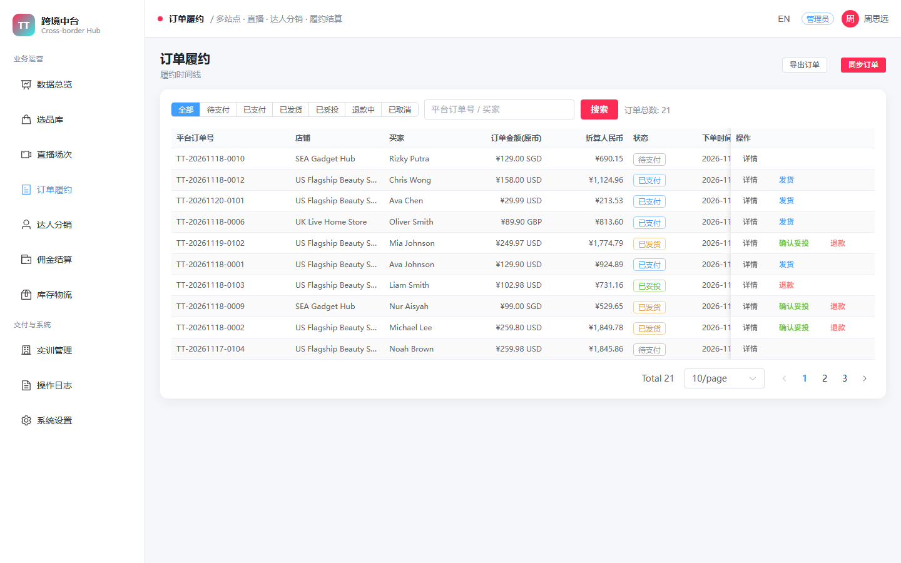
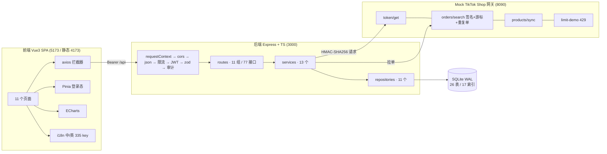

# TikTok 跨境直播电商中台（tiktok-crossborder-commerce-hub）

> 一个面向 **TikTok 跨境直播电商** 的运营中台：把「选品 → 直播场次 → 平台订单同步 → 达人分销 → 多币种结算 → 数据看板」做成一条可运行的业务链。
>
> 后端 TypeScript + Express + SQLite（可切 MySQL） · 前端 Vue 3 + Vite + Element Plus + ECharts · 测试 Vitest + Supertest（**52 用例全绿**）

`Node 24` · `TypeScript 5.7` · `Express 4.21` · `better-sqlite3 12` · `Vue 3.5` · `Vite 6` · `Element Plus 2.9` · `ECharts 5.5` · `Vitest 2.1` · `Swagger UI`

---

## 为什么做这个项目

这个项目是**求职作品集**，对标 **四川迅霆出海科技有限公司 · 全栈开发实习生**。

迅霆出海的主业是 **TikTok 跨境直播电商**，同时在宜宾临港与高校共建跨境直播实训基地。这类团队的真实工作不是「写 CRUD」，而是解决跨境场景特有的问题：

1. **多店铺 × 多站点 × 多币种**：美区、英区、东南亚各自有店铺、币种、时区，运营要在同一个后台里切换查看，汇率必须能追溯「当时用的是哪一天的」。
2. **平台数据靠接口拉**：TikTok Shop 开放平台是**签名 + 游标分页**，网络重试、分页重发都会导致拉重，所以「幂等」是硬要求而不是加分项。
3. **达人分销算钱容易错**：佣金按订单明细计提，一笔订单可能命中多个达人链接；跨月结算要能追溯到每一笔佣金和当时的汇率快照。
4. **人少、要能演示**：实习生和运营要能 5 分钟上手，界面必须有真实数据、图表能看、每一步能讲清楚。

因此项目刻意把三件事做扎实：

- **跨境正确性**：金额全部整数分、时间统一 UTC、汇率快照落库、订单 `(shop_id, platform_order_id)` 唯一键幂等、佣金 `(influencer_id, order_id)` 唯一键防重复计提、发货用条件 UPDATE 防超卖；
- **可演示的业务闭环**：登录 → 看板 → 同步订单 → 发货 → 计提佣金 → 出结算单，全部可在界面点出来（截图见下）；
- **AI 辅助开发留痕**：`docs/ai-workflow.md` 记录了 Prompt 模板、自检清单和 **6 个「AI 生成 → 人工发现 → 修正」的真实案例**，对应 JD 里「熟练使用 AI 编程工具」这一条。

---

## 功能清单

### A. 跨境基础能力
- [x] 多店铺管理（TikTok Shop），店铺授权模拟（access_token）、状态流转（ACTIVE / EXPIRED / PENDING）
- [x] 多站点（US-WEST / US-EAST / UK-LONDON / SEA-SG），站点级币种与时区
- [x] 多币种：币种表 + 汇率表（历史汇率、手动覆盖、反向换算）
- [x] 金额整数分存储 + 展示层格式化；订单/结算落**汇率快照**（`exchange_rate_id` + 本位币金额）
- [x] 时间统一 UTC 存储，日报按站点当地 0 点聚合
- [x] i18n：中文 / English 切换，**335 个 key**（TypeScript 强制中英键对齐）

### B. 业务域
- [x] 选品库：商品/SKU、成本项、类目聚合、状态（ON_SALE / ARCHIVED）
- [x] 利润测算器：售价 / 采购成本 / 头程运费（分段计费）/ 平台费 5% / 达人佣金 → 毛利、毛利率、保本价（**有单元测试**）
- [x] 商品 CSV 导入（逐行校验、错误行号、部分成功）+ CSV 导出（UTF-8 BOM）
- [x] 直播场次：排期、开播/结束/复盘状态机、实时打点、目标达成率、直播 ROI
- [x] 订单同步：Mock 网关拉单（HMAC 签名 + 时间戳防重放 + 游标分页 + 限流 429 重试）
- [x] 订单去重：`UNIQUE(shop_id, platform_order_id)` + `ON CONFLICT DO NOTHING`
- [x] 订单履约：发货扣库存（条件 UPDATE 防超卖）、妥投、退款/退货、状态流水时间线、超时未发货预警
- [x] 达人分销：达人库、专属链接（短码 + UTM）、按订单计提佣金（幂等）
- [x] 佣金结算：按周期生成结算单（事务 + 汇率快照 + 佣金锁定）、状态机 `DRAFT→PENDING→APPROVED→PAID`
- [x] 库存与物流：安全库存告警、库存调整、头程/尾程物流单、异常件标记与推进
- [x] 数据看板：GMV/订单量/客单价/退款率、站点占比（`SUM() OVER ()`）、Top 商品、直播 ROI、运营待办
- [x] 实训基地：学员、实训任务、成绩（upsert）、通过率与完成率

### C. 工程与质量
- [x] 分层：`routes / services / repositories`，仓储只写 SQL，服务层管规则与事务
- [x] 统一响应体 `{code,message,data,requestId,timestamp}` + 统一异常 + 业务错误码
- [x] zod 参数校验（所有写接口）、JWT 鉴权、4 角色权限、限流
- [x] 操作日志审计（自动记录写操作、敏感字段脱敏）
- [x] Swagger UI：`/api/docs`（77 个接口）
- [x] 52 个后端测试（9 文件）全绿；前端 `vue-tsc` 0 error
- [x] 3 张真实运行截图（Edge headless 渲染）

### D. 规划中（未实现，见 `docs/roadmap.md`）
- [ ] 列表虚拟滚动（当前服务端分页）
- [ ] MongoDB 操作日志/浏览流水（spec E17，当前日志落 SQLite）
- [ ] Redis 限流与看板缓存
- [ ] 真实 TikTok Shop 平台对接（需企业资质）
- [ ] Playwright E2E

---

## 界面预览

> 全部为真实运行截图（Edge headless，1440×900），后端为 3100 端口、`db/seed.sql` 种子数据 + 一次订单同步后的结果。

### 登录页


左栏是品牌与三条业务卖点，右栏支持一键填充 4 个演示账号；右上角可切 English。

### 数据看板


GMV ¥17,572.06 / 订单 19 / 客单价 ¥924.84 / 退款率 0.28%，站点占比环形图（美区 78.17%、东南亚 14.32%、英区 7%）由 SQL 窗口函数算出，趋势图为 ECharts 双 Y 轴。

### 订单履约


21 条订单（12 条种子 + 9 条从 Mock 网关同步，重复拉取被幂等去重），同时展示原币金额与折算人民币，按状态给出「发货 / 确认妥投 / 退款」操作。

---

## 技术栈

| 层 | 技术 | 版本 | 用途 |
| --- | --- | --- | --- |
| 运行时 | Node.js | 24.20.0（要求 ≥20） | 后端与构建 |
| 语言 | TypeScript | 5.7.3 | 前后端同语言，`strict` 模式 |
| Web 框架 | Express | 4.21.2 | 路由、中间件 |
| 数据访问 | better-sqlite3 | 12.4.1 | 同步 API、事务简单；生产可切 MySQL 8 |
| 校验 | zod | 3.24.1 | 请求体/查询参数校验 |
| 鉴权 | jsonwebtoken + bcryptjs | 9.0.2 / 2.4.3 | JWT（12h）+ 密码哈希（cost 10） |
| 文档 | swagger-ui-express | 5.0.1 | `/api/docs` 交互式文档 |
| 测试 | Vitest + Supertest | 2.1.9 / 7.0.0 | 接口级集成测试（真实 HTTP） |
| 前端框架 | Vue | 3.5.13 | Composition API + `<script setup>` |
| 构建 | Vite | 6.0.7 | 开发/构建，按库分包 |
| UI | Element Plus | 2.9.1 | 表格、表单、弹窗、时间线 |
| 状态 | Pinia | 2.3.0 | 只存登录态，避免过度设计 |
| 路由 | vue-router | 4.5.0 | **hash 模式**，静态托管零配置 |
| 图表 | ECharts | 5.5.1 | 趋势/占比/条形/分布 |
| 请求 | axios | 1.7.9 | 拦截器：注入 token、剥壳、统一报错、401 跳登录 |
| 类型检查 | vue-tsc | 2.2.0 | 前端 0 error |

---

## 系统架构



关键设计（详见 `docs/architecture.md`）：

1. **幂等靠数据库**：`UNIQUE(shop_id, platform_order_id)` + `ON CONFLICT DO NOTHING`，而不是「先查后插」；
2. **汇率快照**：订单/结算落 `exchange_rate_id`，历史金额不随汇率变动；
3. **状态机白名单**：直播、订单、结算各自定义合法流转，非法转移返回 409；
4. **事务边界**：同步（按页）、发货（明细+库存+物流）、结算（主表+明细+佣金）各自在一个事务里；
5. **鉴权在闸门上**：`apiRouter` 先挂公开路由，再 `use(authenticate)`，新增模块不会漏鉴权。

---

## 目录结构

```
tiktok-crossborder-commerce-hub/
├── backend/                     # 后端 API + Mock 网关（TypeScript）
│   ├── src/
│   │   ├── config/              # 环境变量与业务常量（端口、JWT、限流、汇率本位币）
│   │   ├── db/                  # 连接、建表/种子执行、重置脚本
│   │   ├── middlewares/         # 鉴权、校验、限流、审计、错误处理
│   │   ├── repositories/        # 11 个仓储：只写 SQL，返回行对象
│   │   ├── services/            # 13 个服务：业务规则、状态机、事务、金额换算
│   │   ├── routes/              # 11 组路由 + zod schema
│   │   ├── mock/                # TikTok Shop 网关（签名/游标/重复单/429）
│   │   ├── utils/               # 响应体、JWT、签名、金额、分页、时间、编号
│   │   ├── types/               # 领域类型
│   │   ├── swagger.ts           # OpenAPI 3 文档
│   │   ├── app.ts               # Express 装配
│   │   └── index.ts             # 同时启动 API + Mock，优雅退出
│   ├── tests/                   # 9 个测试文件 / 52 用例
│   └── scripts/                 # 订单列表索引基准脚本
├── frontend/                    # 前端（Vue3 + Vite + TS）
│   └── src/
│       ├── api/                 # axios 封装 + 全部接口与类型
│       ├── components/          # ChartBox（图表壳）、StatCard（KPI 卡）
│       ├── i18n/                # 中/英 335 key
│       ├── layouts/             # 侧边栏 + 顶栏
│       ├── router/              # hash 路由 + 登录守卫（demo=1 自动登录）
│       ├── store/               # Pinia 登录态
│       ├── styles/              # 品牌色、通用类、Element 主题覆盖
│       ├── utils/               # 金额/百分比/状态文案
│       └── views/               # 11 个页面
├── db/                          # schema.sql / seed.sql / mysql/schema.sql
├── docs/                        # 9 篇文档 + screenshots/
├── scripts/                     # serve-dist.mjs（截图/验收静态服务器）
├── docker-compose.yml           # api + mock + web 三服务编排（未本机验证）
├── .env.example                 # 全部环境变量与说明
└── README.md
```

---

## 快速开始

> 以下命令均在本机 **真实执行通过**（Windows 11 + PowerShell + Node v24.20.0）。Windows 下请写 `npm.cmd`。

### 1. 前置要求

- Node.js ≥ 20（推荐 22/24 LTS）
- npm ≥ 10
- 无需安装数据库（默认 SQLite 文件库）

### 2. 安装依赖

```powershell
cd backend
npm.cmd install            # 约 5 分钟（better-sqlite3 预编译二进制）

cd ..\frontend
npm.cmd install
```

### 3. 配置（可选）

默认配置即可跑。要改端口/密钥时：

```powershell
Copy-Item .env.example backend\.env
```

### 4. 初始化数据库

```powershell
cd backend
npm.cmd run db:reset       # 删库重建 + 灌种子，并打印各表行数
```

也可以跳过——首次启动会自动建表并灌种子。

### 5. 启动后端（同时拉起 API 与 Mock 网关）

```powershell
cd backend
npm.cmd run dev            # 开发模式（tsx watch）
# 或
npm.cmd run build
npm.cmd start
```

启动后：

- API：`http://127.0.0.1:3000/api`
- 接口文档：`http://127.0.0.1:3000/api/docs`
- Mock 网关：`http://127.0.0.1:8090/api/v2/health`

> **端口冲突**：本机 3000/8090 被其他进程占用时，用
> `$env:API_PORT="3100"; $env:MOCK_PORT="8091"; $env:TIKTOK_API_BASE="http://127.0.0.1:8091"; npm.cmd start`
> 截图与演示即用 3100/8091（前端构建时设 `VITE_API_BASE_URL=http://127.0.0.1:3100/api`）。

### 6. 启动前端

```powershell
cd frontend
npm.cmd run dev            # http://127.0.0.1:5173
```

生产预览：

```powershell
$env:VITE_API_BASE_URL="http://127.0.0.1:3100/api"
npm.cmd run build
cd ..
node scripts/serve-dist.mjs 4173   # http://127.0.0.1:4173
```

### 7. 访问地址

| 入口 | 地址 |
| --- | --- |
| 前端（dev） | `http://127.0.0.1:5173` |
| 前端（构建产物） | `http://127.0.0.1:4173` |
| API | `http://127.0.0.1:3000/api` |
| Swagger | `http://127.0.0.1:3000/api/docs` |
| Mock 网关 | `http://127.0.0.1:8090/api/v2/health` |

### 8. 5 分钟演示路径

1. 用 `admin / Admin@123` 登录；
2. 看板看 GMV、站点占比、Top 商品；
3. 订单履约 → 点「同步订单」→ 提示 `fetched=11, inserted=9, duplicated=2`（幂等生效）；
4. 对 `PAID` 订单点「发货」，再「确认妥投」；
5. 达人分销 → 佣金 tab → 对某条 `PENDING` 佣金点「计提」；
6. 结算与佣金 → 「新建结算单」→ 选达人 + 周期 → 生成；
7. 操作日志 → 看到前面所有写操作的审计记录。

---

## 默认账号

| 用户名 | 密码 | 角色 | 说明 |
| --- | --- | --- | --- |
| `admin` | `Admin@123` | 管理员 | 全部权限，含用户管理与审计统计 |
| `operator` | `Operator@123` | 运营 | 商品/直播/订单/达人/结算/库存/实训写操作 |
| `host` | `Host@123` | 主播 | 直播场次开播、打点 |
| `agency` | `Agency@123` | 机构代理 | 达人与佣金只读 |

> 密码以 bcrypt（cost 10）存于 `db/seed.sql`，登录接口不区分「用户不存在」与「密码错误」。

---

## 主要接口

| 方法 | 路径 | 说明 |
| --- | --- | --- |
| POST | `/api/auth/login` | 登录，返回 JWT（12h） |
| GET | `/api/dashboard/overview?days=14` | 看板一屏数据（KPI/趋势/站点占比/Top 商品/待办） |
| GET | `/api/products?keyword=&category=&page=` | 选品库分页 |
| POST | `/api/products/profit-calc` | 利润测算（毛利/毛利率/保本价） |
| POST | `/api/orders/sync` | 从 Mock 网关拉单（签名 + 游标 + 幂等） |
| POST | `/api/orders/:id/ship` | 发货（扣库存，库存不足 409） |
| POST | `/api/orders/:id/refund` | 退款/退货 |
| POST | `/api/affiliates/orders/:orderId/accrue` | 按订单计提达人佣金（幂等） |
| POST | `/api/settlements` | 生成结算单（事务 + 佣金锁定） |
| GET | `/api/inventory/low-stock` | 安全库存告警 |

完整 77 个接口见 `docs/api.md` 或运行后的 `http://127.0.0.1:3000/api/docs`。

真实调用示例（本机实测）：

```bash
curl -X POST http://127.0.0.1:3100/api/auth/login \
  -H "Content-Type: application/json" \
  -d '{"username":"admin","password":"Admin@123"}'
# → {"code":0,"message":"success","data":{"token":"eyJ…","user":{"id":1,"username":"admin","role":"ADMIN","realName":"周思远"}}}

curl -X POST http://127.0.0.1:3100/api/orders/sync \
  -H "Authorization: Bearer <token>" -H "Content-Type: application/json" \
  -d '{"shopId":1,"pageSize":4}'
# → {"code":0,"data":[{"shopId":1,"fetched":11,"inserted":9,"duplicated":2,"failed":0,"pages":3,"errors":[]}]}
```

---

## 测试

### 怎么跑

```powershell
cd backend
npm.cmd test              # Vitest + Supertest，一次性跑完
npm.cmd run type-check    # tsc --noEmit
```

```powershell
cd frontend
npm.cmd run type-check    # vue-tsc --noEmit
npm.cmd run build         # vite build
```

### 当前通过情况（真实输出）

| 项目 | 结果 |
| --- | --- |
| 后端测试 | **Test Files 9 passed (9)，Tests 52 passed (52)，Duration 35.01s** |
| 后端类型检查 | 通过（0 error） |
| 后端构建 | 通过（`tsc`，产物 `backend/dist`） |
| 前端类型检查 | 通过（`vue-tsc`，0 error） |
| 前端构建 | 通过（`✓ built in 1m 30s`，含 ECharts/Element 分包） |

### 覆盖范围（9 个文件 / 52 用例）

| 文件 | 用例 | 覆盖点 |
| --- | --- | --- |
| `smoke.test.ts` | 1 | 配置加载 + 建表脚本可执行 |
| `auth.test.ts` | 6 | 登录成功/失败/停用、`/me`、注册禁 ADMIN、审计日志脱敏 |
| `profit.test.ts` | 6 | 毛利/毛利率/保本价精确值、亏损判定、含额外成本、元/分两种入参等价 |
| `currency.test.ts` | 6 | 历史汇率取值、反向换算、同币种、无效日期、汇率新增校验 |
| `orders.test.ts` | 8 | 同步幂等（11/9/2）、二次同步全重复、发货扣库存、库存不足 409、妥投、退款超限、导出 CSV、超时筛选 |
| `settlement.test.ts` | 6 | 佣金计提幂等、未妥投拒绝、结算单生成、重复周期 409、状态机、PAID 锁定佣金 |
| `products.test.ts` | 7 | 分页/筛选、类目聚合、CSV 导入部分成功与行号、空文件、导出 BOM、利润接口 |
| `dashboard.test.ts` | 5 | KPI 数值、趋势补齐、站点占比合计 100、Top 商品、待办与审计统计 |
| `mockGateway.test.ts` | 7 | token 获取、签名错误码、时间戳过期、游标分页、重复单、429 限流、products/sync |

> 测试不使用 mock 数据库：`tests/helpers.ts` 起**内存 SQLite + 随机端口 Mock 网关 + 真实 HTTP**，订单同步链路（签名 → 游标 → 幂等）是端到端跑通的。

索引性能实测见 `docs/performance.md`（1 万条与 10 万条订单，索引前后中位数对比 + 执行计划）。

---

## 与岗位要求的对应关系

| JD 原文要点 | 本项目实现位置 |
| --- | --- |
| 借助 **AI 编程工具**完成 Web 应用开发全流程（前端页面、后端接口、前后端联调、性能调优） | 全仓库；过程留痕 `docs/ai-workflow.md`（Prompt 模板、自检清单、6 个真实修正案例）；性能实测 `docs/performance.md` + `backend/scripts/bench-orders.mjs` |
| 前端页面 | `frontend/src/views/`（11 个页面：登录、看板、选品、直播、订单、达人、结算、库存、实训、日志、设置）、`frontend/src/components/`、`frontend/src/styles/index.css` |
| 后端接口 | `backend/src/routes/`（11 组 / 77 接口）、`backend/src/services/`（13 个）、`backend/src/repositories/`（11 个） |
| 前后端联调 | `frontend/src/api/index.ts`（全部接口封装与类型）、`frontend/src/api/request.ts`（拦截器/统一错误/401 跳转）、后端 `docs/api.md` 契约、Swagger `/api/docs` |
| 性能调优 | `docs/performance.md`（索引前后对比、10 万行退化分析、预聚合 `daily_report`）、`frontend/vite.config.ts`（按库分包）、`ChartBox.vue`（懒初始化/销毁） |
| 参与**需求拆解**，形成开发文档 | `docs/requirements.md`（14 条功能 + Given/When/Then 验收标准 + WBS 估时 + 真实验收结果） |
| 代码注释 | 全部源文件关键逻辑中文注释（如 `backend/src/services/orderService.ts` 的幂等说明、`backend/src/utils/sign.ts` 的签名规则） |
| **代码评审** | `docs/code-review.md`（15 条：6 高 / 6 中 / 3 低，含风险等级与修改结论）、提交前 10 项自查清单 |
| HTML / CSS / JS | `frontend/index.html`、`frontend/src/styles/index.css`（品牌色变量、响应式断点）、Vue SFC |
| Vue 或 React | Vue 3.5 Composition API + `<script setup>` + Pinia + vue-router（hash） |
| Node（Java/Python/Node 至少一门） | Node 24 + TypeScript 严格模式，后端 58 个源文件 / 4,926 行 |
| MySQL 或 MongoDB | SQLite（better-sqlite3，WAL、外键、事务）+ MySQL 8 建表脚本 `db/mysql/schema.sql`；索引与执行计划见 `docs/database.md` §4 |
| 熟练使用 AI 编程工具（Cursor / Claude Code / Copilot） | `docs/ai-workflow.md` §2 Prompt 模板、§3 八条自检清单、§4 六个真实案例（含 diff）、§5 哪些不交给 AI |

---

## 后续规划

近期（1~2 周）与中长期计划见 `docs/roadmap.md`，摘要：

1. **性能**：ECharts/Element Plus 按需引入（当前 `charts` 1.03 MB、`element` 1.1 MB）、补 `(status, paid_at)` 复合索引、列表虚拟滚动；
2. **工程**：`docker compose up` 真机验证、GitHub Actions（type-check + test + build）、Playwright E2E；
3. **业务**：真实 TikTok Shop 开放平台对接、多租户行级权限、WebSocket 实时中控台、三方对账。

---

## 已知限制

| 限制 | 说明 |
| --- | --- |
| 本机 3000/8090 端口被其他进程占用 | 演示用 `API_PORT=3100`、`MOCK_PORT=8091`；代码默认值仍是 3000/8090 |
| MySQL 分支未在本机实测 | 机器无 MySQL/Docker；`db/mysql/schema.sql` 已按 MySQL 8 编写，差异清单见 `docs/database.md` §7 |
| `docker-compose.yml` 未实际执行 | 同上（无 Docker）；`backend/Dockerfile`、`frontend/Dockerfile` 按多阶段构建标准编写，待有 Docker 环境验证 |
| 列表虚拟滚动未实现 | 当前服务端分页（每页 10~20 条），虚拟滚动列入 roadmap |
| 限流为单实例内存实现 | 多实例部署需换 Redis 令牌桶（`docs/code-review.md` CR-15） |
| MongoDB 示例未落地 | spec E17 建议审计日志写 Mongo，本项目落在 SQLite `audit_log`；Mongo 版本列入 roadmap |
| 未接入真实 TikTok Shop | Mock 网关按官方接口形状实现（签名/游标/错误码/429），真实接入需企业资质 |

---

## License

[MIT](LICENSE) © 2026 zhoushiba
