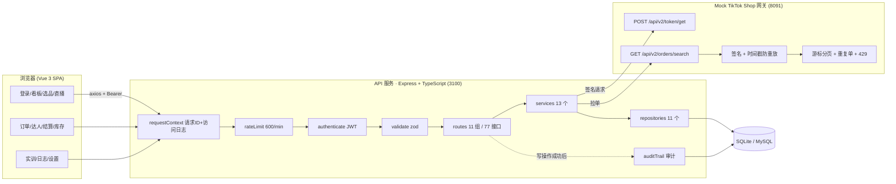
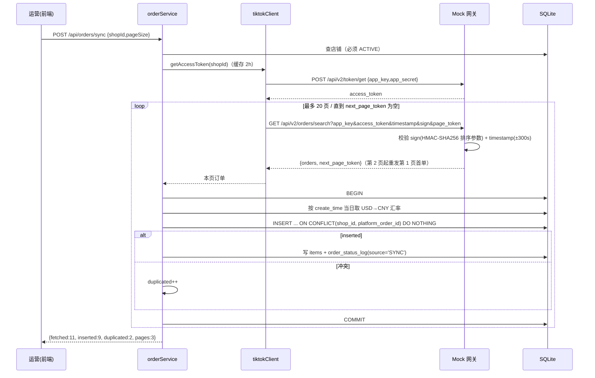
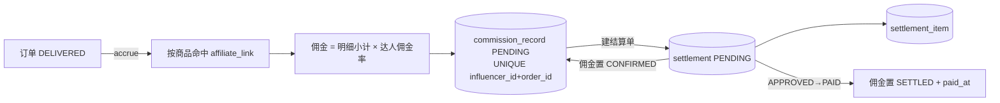

# 架构文档 · TikTok 跨境直播电商中台

## 1. 设计目标

1. **一条链可演示**：选品 → 直播 → 订单 → 分销 → 结算 → 看板，任何一环都能在界面上点出来。
2. **跨境正确性优先**：金额用「分」、时间用 UTC、汇率取「生效日快照」、平台拉单靠「幂等键」。
3. **可替换基础设施**：本地 SQLite 零依赖启动；生产切 MySQL 只改连接与建表脚本，不改业务代码（SQL 保持标准子集，见 §8）。
4. **可测试**：不 mock 掉数据库与 HTTP，测试直接在内存库 + 真实 Mock 网关上跑端到端。

## 2. 总体结构



## 3. 后端分层

| 层 | 目录 | 职责 | 不该做的事 |
| --- | --- | --- | --- |
| 入口 | `backend/src/index.ts` | 初始化数据库、同时拉起 API 与 Mock、优雅退出 | 写业务逻辑 |
| 应用装配 | `backend/src/app.ts` | 中间件顺序、`/api/docs`、404/错误兜底 | 直接访问数据库 |
| 路由 | `backend/src/routes/*.ts` | HTTP 语义、鉴权、zod 校验、调用 service、`sendOk` | SQL、事务 |
| 服务 | `backend/src/services/*.ts` | 业务规则、状态机、事务、跨仓储编排、金额换算 | 拼 SQL 字符串 |
| 仓储 | `backend/src/repositories/*.ts` | 预编译 SQL、行 → 对象映射 | 业务判断 |
| 基础设施 | `backend/src/{config,db,middlewares,utils}` | 配置、连接、校验/鉴权/日志、纯函数工具 | 依赖 service |

**为什么这样分**：仓储只做 SQL，换 MySQL 时只动这里；服务层是纯 TS，单测不需要起 HTTP；路由层薄到可以一眼看完，便于代码评审时检查鉴权有没有漏。

中间件顺序（`backend/src/app.ts`）：

```
requestContext → cors → express.json(5mb) → urlencoded
  → rateLimit(/api) → GET / → /api/docs → /api(apiRouter)
  → notFoundHandler → errorHandler
```

`apiRouter` 内部顺序是：`/auth`、`/system`（公开）→ `authenticate` 闸门 → 11 组业务路由。**鉴权放在闸门上而不是每个 handler 里**，新增模块时不会忘记加。

## 4. 关键流程

### 4.1 平台订单同步（幂等 + 签名 + 游标 + 汇率快照）



要点：
- **幂等靠数据库约束**（`UNIQUE(shop_id, platform_order_id)` + `ON CONFLICT DO NOTHING`），不是靠「先查再插」，避免并发下双写；
- **汇率在落库时固化**（写 `exchange_rate_id` 与 `base_amount_cent`），之后汇率变动不影响历史订单；
- **整页一个事务**，一页失败不影响已落库的页，`errors[]` 记录失败原因。

### 4.2 发货：库存扣减与状态机

```mermaid
flowchart TD
    A[POST /orders/:id/ship] --> B{订单状态 = PAID?}
    B -- 否 --> X[40900 状态冲突]
    B -- 是 --> C[事务开始]
    C --> D[遍历明细 deduct(productId, shopId, qty)]
    D --> E{受影响行数 > 0?}
    E -- 否 --> F[回滚 + 40900 库存不足]
    E -- 是 --> G[写 logistics_order FIRST_LEG]
    G --> H[updateStatus SHIPPED + shipped_at]
    H --> I[commit]
```

单条扣减 SQL 用 `UPDATE inventory SET available_qty = available_qty - ? WHERE product_id=? AND shop_id=? AND available_qty >= ?`，**把并发判断交给数据库**，不做「先 select 再 update」。

### 4.3 佣金计提与结算



- 结算单状态机：`DRAFT → PENDING → APPROVED → PAID`，`PENDING` 可退回 `DRAFT`（佣金回到 `PENDING` 以便重新结算）；
- 建单在**一个事务**里完成「主表 + 明细 + 佣金改状态」，避免出现「单子建了但佣金没锁」的半成品；
- 本位币金额 = 佣金原币 × 期末日汇率，`exchange_rate_id` 落在结算单上。

### 4.4 统一响应与错误

```json
{ "code": 0, "message": "success", "data": { }, "requestId": "…", "timestamp": "2026-11-21T17:00:00.000Z" }
```

| 场景 | HTTP | code |
| --- | --- | --- |
| 参数校验失败（zod） | 400 | 40000 |
| 未登录 / token 失效 | 401 | 40100 |
| 无权限 / 账号禁用 | 403 | 40300 |
| 资源不存在 | 404 | 40400 |
| 状态冲突 / 唯一键冲突 / 库存不足 | 409 | 40900 |
| 限流 | 429 | 42900 |
| 未预期异常 | 500 | 50000 |

`errorHandler` 会把 SQLite 的 `UNIQUE constraint failed` 映射成 409、`FOREIGN KEY` 映射成 400，**未知错误只回通用文案**，堆栈只进服务端日志。

## 5. 前端架构

```mermaid
flowchart LR
    R[router · hash 模式] --> G{守卫：已登录?}
    G -- 否, query.demo=1 --> L1[自动登录 admin（演示/截图）]
    G -- 否 --> L2[/login]
    G -- 是 --> LY[MainLayout 侧边栏+顶栏]
    LY --> P1[DashboardView]
    LY --> P2[ProductsView]
    LY --> P3[LiveView]
    LY --> P4[OrdersView]
    LY --> P5[AffiliatesView]
    LY --> P6[SettlementsView]
    LY --> P7[InventoryView]
    LY --> P8[TrainingView]
    LY --> P9[LogsView]
    LY --> P10[SettingsView]
    P1 -.->|ECharts| CH[ChartBox]
    P1 --> ST[Pinia auth store]
    P1 --> AX[axios 封装 request.ts]
```

- **hash 路由**（`createWebHashHistory`）：静态托管不需要服务端 rewrite，`file://`/任意静态服务器都能直接打开；
- **请求封装**：拦截器注入 `Bearer`、剥掉 `{code,message,data}` 外壳、统一 `ElMessage.error`、401 清 token 跳登录；
- **状态管理**：只把「登录态」放进 Pinia，页面数据就近用 `ref`，避免过度设计；
- **构建分包**：`vite.config.ts` 把 vue / element-plus / echarts 拆成独立 chunk，业务代码改动不会让用户重下 1MB 图表库；
- **图表组件**：`ChartBox.vue` 统一处理 init / `setOption` / resize / dispose，页面只传 `option`。

## 6. Mock 网关设计（`backend/src/mock/app.ts`）

| 端点 | 行为 |
| --- | --- |
| `POST /api/v2/token/get` | 校验 `app_key/app_secret`，错误返回 `401 + code=40103` |
| `GET /api/v2/orders/search` | 校验 `sign`（HMAC-SHA256，参数按 key 升序拼接）与 `timestamp`（±300s）；`pageSize` 上限 4；`next_page_token` 为 base64 游标；**offset>0 时重发第 1 页首单**用于验证幂等 |
| `GET /api/v2/orders/detail` | 单笔详情 |
| `POST /api/v2/products/sync` | 商品回传（幂等 upsert 演示） |
| `GET /api/v2/limit-demo` | 3 次/分钟，超限 429（配合客户端指数退避重试） |

它和 API 服务**同进程不同端口**启动（`backend/src/index.ts`），也可以 `npm run mock` 单独起，方便前端在真实网关不可用时联调。

## 7. 数据访问与事务

- `better-sqlite3` 是同步 API，天然适合「短事务 + 明确顺序」；开启 `journal_mode=WAL` 与 `foreign_keys=ON`；
- `withTransaction(fn)`（`backend/src/db/index.ts`）封装 `BEGIN/COMMIT/ROLLBACK`，service 层只关心「哪些语句在一个事务里」；
- 列表查询统一「先 COUNT 后 LIMIT/OFFSET」，返回 `{list,total,page,pageSize,totalPages,hasNext}`；
- 报表类查询用窗口函数（`SUM() OVER ()`、`RANK()`）在库内完成占比计算，避免把全量数据捞到 Node 里再算。

## 8. 从 SQLite 切到 MySQL

| 关注点 | 现状 | 迁移做法 |
| --- | --- | --- |
| 建表 | `db/schema.sql`（SQLite 方言） | 用 `db/mysql/schema.sql`（已附）建库 |
| 自增主键 | `INTEGER PRIMARY KEY AUTOINCREMENT` | `BIGINT AUTO_INCREMENT` |
| 时间 | `TEXT` 存 `YYYY-MM-DD HH:mm:ss`（UTC） | `DATETIME` + 连接时区 `+00:00` |
| 幂等写入 | `ON CONFLICT ... DO NOTHING` | `INSERT IGNORE` 或 `ON DUPLICATE KEY UPDATE id=id` |
| 布尔 | `INTEGER 0/1` | `TINYINT(1)` |
| 连接 | 单文件 | mysql2 连接池（`DB_CLIENT=mysql` 时切换，见 `docs/deployment.md`） |

业务 SQL 已避开双方言差异较大的函数（不使用 `strftime`、`datetime('now','-7 day')` 之外的专有写法；跨库日期区间在 Node 侧算好后以参数传入的情况见 `reportRepo.gmvTrend` 的说明）。

## 9. 已知架构取舍

| 取舍 | 原因 | 代价 |
| --- | --- | --- |
| 同步 SQLite 而非异步 ORM | 零依赖启动、事务语义清晰、测试快 | 高并发写会排队（本作品集场景足够） |
| 比率/占比在 SQL 里算 | 数据量小、少一次序列化 | 复杂报表可读性下降，已在 `reportRepo.ts` 加注释 |
| 限流用内存计数 | 单实例演示足够 | 多实例需换 Redis（已列入 roadmap） |
| Mock 与 API 同仓同进程 | 一条命令起两服务，面试演示成本低 | 生产需拆独立部署（`docker-compose.yml` 已按两服务编排） |
| 前端只用 Pinia 存登录态 | 页面数据生命周期短 | 跨页缓存需自行加 store |
