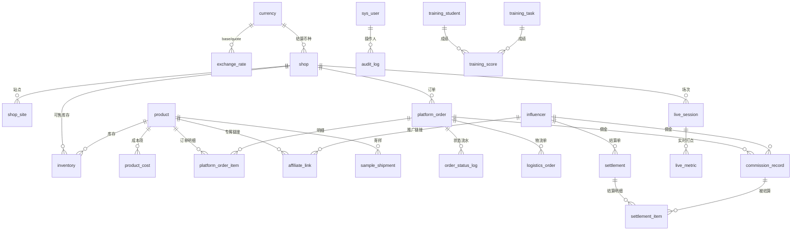

# 数据库设计 · TikTok 跨境直播电商中台

- 本地默认：**SQLite（better-sqlite3）**，建表 `db/schema.sql`，种子 `db/seed.sql`
- 生产可选：**MySQL 8**，建表 `db/mysql/schema.sql`（字段语义一一对应）
- 表数量：**26 张**（业务 22 + 系统 4 相关），索引 **17 个**（不含主键与 UNIQUE 自动索引）

## 1. 全局约定

| 约定 | 说明 |
| --- | --- |
| 金额 | 一律 `INTEGER` 存**分**，字段名以 `_cent` 结尾；展示层除以 100。理由：跨境换算多，浮点会累积误差 |
| 汇率 | `REAL`（如 7.12）；换算在 Node 侧用 `Math.round(cent * rate)`，结果仍是整数分 |
| 时间 | `TEXT` 存 UTC `YYYY-MM-DD HH:mm:ss`（`datetime('now')`）；前端按站点时区展示 |
| 主键 | `INTEGER PRIMARY KEY AUTOINCREMENT` |
| 外键 | `REFERENCES` + 应用层 `foreign_keys=ON`；删除一律用状态字段软删（`status`），不物理删业务数据 |
| 枚举 | 用 `TEXT` + `CHECK (... IN (...))`（如 `role`、`status`），既自解释又能被数据库兜底 |
| 命名 | 表名小写复数/单数混用按领域：`platform_order`、`commission_record`；字段 `snake_case` |

## 2. ER 概览



## 3. 表清单与字段说明

### 3.1 基础与跨境能力

**`currency`（币种）**：`code(PK)`、`name`、`symbol`、`decimal_digits`
> 只存展示所需的元数据；换算一律走 `exchange_rate`。

**`exchange_rate`（汇率，含历史）**：`id`、`base_currency`、`quote_currency`、`rate REAL`、`effective_date`、`source`、`created_at`
> `UNIQUE(base_currency, quote_currency, effective_date)`。查询「某日汇率」= `WHERE effective_date <= ? ORDER BY effective_date DESC LIMIT 1`（`currencyRepo.latestRate`）。种子含 10 条（2026-11-01 与 2026-11-20 两批），可演示「历史汇率不可变」。

**`shop`（店铺）**：`id`、`shop_name`、`platform`、`region CHECK IN ('US','UK','SEA')`、`currency_code`、`timezone`、`app_key`、`app_secret`、`access_token`、`token_expires_at`、`status CHECK IN ('ACTIVE','EXPIRED','PENDING')`、`authorized_at`、`created_at`
> 跨境核心表：站点决定币种与时区，`app_key/app_secret` 参与 Mock 网关签名。接口返回时脱敏。

**`shop_site`（站点）**：`id`、`shop_id`、`site_code`、`site_name`、`country`、`currency_code`、`timezone`
> `UNIQUE(shop_id, site_code)`。一个店铺可以有多个发货/经营站点（本项目 4 个：US-WEST、US-EAST、UK-LONDON、SEA-SG）。

### 3.2 商品与库存

**`product`（商品/SKU）**：`id`、`sku UNIQUE`、`title`、`image_url`、`category`、`cost_price_cent`、`sale_price_cent`、`currency_code`、`weight_g`、`volume_cm3`、`commission_rate REAL`、`shipping_mode`、`site_code`、`status CHECK IN ('ON_SALE','ARCHIVED')`、`created_at`
> 利润测算所需的全部因子都在这一张表里，避免多表 JOIN。

**`product_cost`（成本项）**：`id`、`product_id`、`cost_type`、`amount_cent`、`currency_code`、`note`、`created_at`
> 采购/包材/质检等附加成本，测算时累加进 `extra_cost_cny_cent`。

**`inventory`（库存）**：`id`、`product_id`、`shop_id`、`available_qty`、`safety_qty`、`warehouse`、`updated_at`
> `UNIQUE(product_id, shop_id)`；低库存 = `available_qty < safety_qty`。**扣减用条件 UPDATE**（`WHERE available_qty >= ?`）防止超卖。

### 3.3 直播

**`live_session`（直播场次）**：`id`、`shop_id`、`title`、`host_name`、`scheduled_at`、`duration_min`、`gmv_target_cent`、`actual_gmv_cent`、`status CHECK IN ('PLANNED','LIVE','ENDED','REVIEWED','CANCELLED')`、`viewers`、`peak_online`、`orders_count`、`review_note`、`created_at`

**`live_metric`（实时打点）**：`id`、`session_id`、`metric_at`、`online_count`、`gmv_cent`、`orders`、`conversion_rate`
> 中控台折线图的数据源；打点同时把累计值回写 `live_session`，避免看板再聚合。

### 3.4 订单与履约

**`platform_order`（平台订单）**：`id`、`shop_id`、`platform_order_id`、`status CHECK IN ('PENDING','PAID','SHIPPED','DELIVERED','REFUNDING','REFUNDED','CANCELLED')`、`buyer_name`、`currency_code`、`total_amount_cent`、`exchange_rate_id`、`base_amount_cent`、`site_code`、`paid_at`、`shipped_at`、`delivered_at`、`refund_status`、`refund_amount_cent`、`created_at`
> **`UNIQUE(shop_id, platform_order_id)` 是幂等的根本**；`exchange_rate_id` + `base_amount_cent` 是「汇率快照」，保证历史金额可追溯。

**`platform_order_item`（订单明细）**：`id`、`order_id`、`product_id`、`sku`、`title`、`quantity`、`unit_price_cent`、`subtotal_cent`
> 佣金按明细小计乘达人费率计提，所以明细必须独立成表而不是 JSON。

**`order_status_log`（状态流水）**：`id`、`order_id`、`from_status`、`to_status`、`source`（`SYNC`/`MANUAL`/`SHIP`…）、`remark`、`created_at`
> 订单详情页时间线；同时是排查「这单为什么被取消」的唯一证据链。

**`logistics_order`（物流单）**：`id`、`order_id`、`type`（`FIRST_LEG`/`LAST_LEG`）、`carrier`、`tracking_no`、`status CHECK IN ('CREATED','PICKED_UP','IN_TRANSIT','CUSTOMS','DELIVERED','EXCEPTION')`、`origin`、`destination`、`exception_flag`、`exception_reason`、`created_at`

### 3.5 达人分销

**`influencer`（达人）**：`id`、`nickname`、`handle UNIQUE`、`followers`、`category`、`commission_rate REAL`、`total_gmv_cent`、`region`、`status`、`created_at`

**`affiliate_link`（专属链接）**：`id`、`influencer_id`、`product_id`、`link_code UNIQUE`、`utm_source`、`utm_medium`、`utm_campaign`、`clicks`、`conversions`、`gmv_cent`、`created_at`
> 归因依据：订单明细的 `product_id` 命中该达人的链接，即认为该笔 GMV 归属该达人（简化模型，够讲清「归因」概念）。

**`sample_shipment`（寄样）**：`id`、`influencer_id`、`product_id`、`tracking_no`、`status`、`shipped_at`、`created_at`

**`commission_record`（佣金）**：`id`、`influencer_id`、`order_id`、`link_id`、`gmv_cent`、`commission_rate`、`commission_amount_cent`、`currency_code`、`status CHECK IN ('PENDING','CONFIRMED','SETTLED')`、`created_at`
> `UNIQUE(influencer_id, order_id)` **防止同一单重复计提**；状态流转：`PENDING →(建结算单)→ CONFIRMED →(付清)→ SETTLED`。

### 3.6 结算

**`settlement`（结算单）**：`id`、`settlement_no UNIQUE`、`influencer_id`、`period_start`、`period_end`、`total_gmv_cent`、`commission_amount_cent`、`currency_code`、`exchange_rate_id`、`base_amount_cent`、`status CHECK IN ('DRAFT','PENDING','APPROVED','PAID')`、`remark`、`created_at`、`paid_at`

**`settlement_item`（结算明细）**：`id`、`settlement_id`、`commission_id`、`amount_cent`、`UNIQUE(settlement_id, commission_id)`
> 一张结算单只能装一次同一笔佣金；这是「结算不重复」的第二道闸（第一道是佣金状态）。

### 3.7 报表

**`daily_report`（日报，预聚合）**：`id`、`shop_id`、`report_date`、`timezone`、`orders_count`、`gmv_cent`、`refund_amount_cent`、`top_product_id`、`created_at`、`UNIQUE(shop_id, report_date)`
> 按「站点当地 0 点」聚合，用来回答「为什么不用每次实时算 30 天趋势」（见 `docs/performance.md` §4）。

### 3.8 实训基地

**`training_student`（学员）**：`id`、`name`、`school`、`major`、`phone`、`status`、`created_at`
**`training_task`（实训任务）**：`id`、`title`、`description`、`points`、`due_date`、`status`、`created_at`
**`training_score`（成绩）**：`id`、`student_id`、`task_id`、`score`、`feedback`、`graded_at`、`UNIQUE(student_id, task_id)`
> 成绩用「学员 × 任务」唯一键做 upsert，改分不会产生多条记录。

### 3.9 系统

**`sys_user`（用户）**：`id`、`username UNIQUE`、`password_hash`、`real_name`、`role CHECK IN ('ADMIN','OPERATOR','HOST','AGENCY')`、`email`、`status`、`created_at`
> `password_hash` 为 bcrypt（cost 10）；查询用户列表时**永不返回该字段**（`userRepo.listSafe`）。

**`audit_log`（操作日志）**：`id`、`user_id`、`username`、`action`、`resource`、`resource_id`、`method`、`path`、`ip`、`detail`、`created_at`
> `action` 形如 `PATCH inventory`（方法 + 资源），`detail` 为请求体摘要且脱敏。

**`sys_config`（配置）**：`id`、`config_key UNIQUE`、`config_value`、`description`、`updated_at`
> 种子含 6 项：`BASE_CURRENCY`、`ORDER_SYNC_PAGE_SIZE`、`REFUND_WINDOW_DAYS`、`COMMISSION_MIN_PAYOUT`、`LIVE_ROI_ALERT`、`DEFAULT_TIMEZONE`。

## 4. 索引策略

| 索引 | 表（列） | 服务的查询 | 说明 |
| --- | --- | --- | --- |
| `idx_order_shop_created` | `platform_order(shop_id, created_at DESC)` | 订单中心按店铺翻页 | 复合索引覆盖「过滤 + 排序」，避免临时 B-Tree |
| `idx_order_created` | `platform_order(created_at)` | 看板按天聚合、趋势 | 范围扫描 |
| `idx_order_status` | `platform_order(status)` | 状态筛选、超时未发货计数 | 低基数但高频 |
| `idx_order_item_order` | `platform_order_item(order_id)` | 订单详情明细 | 防 N+1 的必要索引 |
| `idx_order_log_order` | `order_status_log(order_id)` | 状态时间线 | |
| `idx_commission_influ` | `commission_record(influencer_id, status)` | 达人佣金列表、待结算 | 复合前缀最左匹配 |
| `idx_commission_order` | `commission_record(order_id)` | 按订单查佣金 | |
| `idx_affiliate_influ` | `affiliate_link(influencer_id)` | 达人详情链接 | |
| `idx_live_session_shop` | `live_session(shop_id, scheduled_at)` | 场次列表/待开播 | |
| `idx_live_metric_session` | `live_metric(session_id, metric_at)` | 中控台曲线 | |
| `idx_inventory_product` | `inventory(product_id)` | 低库存聚合 | `UNIQUE(product_id, shop_id)` 已覆盖部分场景 |
| `idx_logistics_order` | `logistics_order(order_id)` | 订单物流 | |
| `idx_daily_report_shop` | `daily_report(shop_id, report_date)` | 日报查询 | |
| `idx_audit_created` | `audit_log(created_at DESC)` | 日志分页倒序 | |
| `idx_audit_user` | `audit_log(username)` | 按人筛选 | |
| `idx_training_score_std` | `training_score(student_id)` | 学员成绩 | |

另外依赖的 UNIQUE 约束（自动索引）：`platform_order(shop_id, platform_order_id)`、`commission_record(influencer_id, order_id)`、`settlement_item(settlement_id, commission_id)`、`exchange_rate(base, quote, effective_date)`、`inventory(product_id, shop_id)`、`training_score(student_id, task_id)`。

### 索引命中实测（1 万条订单，中位数）

| 查询 | 无索引 | 有索引 | 提升 | 执行计划变化 |
| --- | --- | --- | --- | --- |
| 店铺+状态翻页 | 2.572 ms | 2.306 ms | 1.12× | 临时排序 B-Tree → 无排序 |
| 状态+关键词搜索 | 3.610 ms | 2.383 ms | 1.52× | `SCAN` → `SEARCH USING idx_order_status` |
| 近 7 天按天聚合 | 6.073 ms | 3.997 ms | 1.52× | `SCAN` → `SEARCH USING idx_order_created` |
| 超时未发货计数 | 2.667 ms | 1.025 ms | 2.60× | `SCAN` → `SEARCH USING idx_order_status` |

完整方法与 10 万条对比见 `docs/performance.md`，复跑脚本 `backend/scripts/bench-orders.mjs`。

## 5. 典型查询

**取「不晚于某日」的汇率（结算可追溯的关键）**

```sql
SELECT id, rate, effective_date
FROM exchange_rate
WHERE base_currency = ? AND quote_currency = ? AND effective_date <= ?
ORDER BY effective_date DESC
LIMIT 1;
```

**站点 GMV 占比（窗口函数，一次扫描出占比）**

```sql
SELECT s.region,
       SUM(o.base_amount_cent) AS gmv_cent,
       ROUND(SUM(o.base_amount_cent) * 100.0 / SUM(SUM(o.base_amount_cent)) OVER (), 2) AS ratio
FROM platform_order o
JOIN shop s ON s.id = o.shop_id
WHERE o.status NOT IN ('CANCELLED', 'REFUNDED')
GROUP BY s.region
ORDER BY gmv_cent DESC;
```

**待结算佣金汇总**

```sql
SELECT COUNT(*) AS commission_count,
       COALESCE(SUM(commission_amount_cent), 0) AS pending_amount_cent
FROM commission_record
WHERE influencer_id = ? AND status = 'PENDING'
  AND created_at >= ? AND created_at < ?;
```

## 6. 种子数据规模（`db/seed.sql`）

| 表 | 行数 | 说明 |
| --- | --- | --- |
| `sys_user` | 4 | admin / operator / host / agency（bcrypt） |
| `currency` / `exchange_rate` | 4 / 10 | 两批汇率，可演示历史取值 |
| `shop` / `shop_site` | 4 / 4 | 美区 2、英区 1、东南亚 1（含 1 个 EXPIRED） |
| `product` / `inventory` | 12 / 12 | 4 个 SKU 低于安全库存 |
| `live_session` / `live_metric` | 4 / 10 | 含 1 场进行中 |
| `platform_order` / `_item` / `_log` | 12 / 19 / 10 | 6 种状态覆盖 |
| `logistics_order` | 6 | 含 1 条异常件 |
| `influencer` / `affiliate_link` | 6 / 8 | 含 1 个 PENDING 达人 |
| `commission_record` | 5 | PENDING×3、CONFIRMED、SETTLED |
| `settlement` / `settlement_item` | 2 / 2 | 1 张 PENDING、1 张 PAID |
| `training_student` / `_task` / `_score` | 6 / 4 / 10 | 实训演示 |
| `audit_log` | 5 | 初始日志 |
| `sys_config` | 6 | 业务开关 |

时间全部用 `datetime('now','-N day')` 相对当前时间生成，**任何时候重置数据库都有「最近 30 天」的数据**，截图与演示不会出现空图表。

## 7. 重置与校验

```powershell
cd backend
npm.cmd run db:reset   # 删库重建 + 重新灌种子，并打印各表行数
```

`backend/src/db/reset.ts` 会输出 `sys_user / shop / product / platform_order / commission_record / settlement / audit_log` 的行数，用于确认种子完整。
